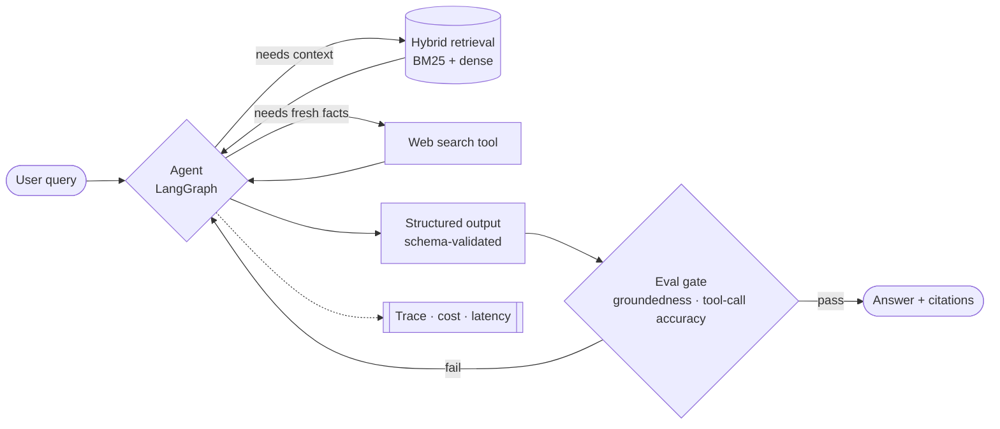

<!-- Header -->

  

  

  
  
  
  
  

---

### 👋 Hi, I'm Anusha

Three years of NLP and LLM work in production. These days that means **LangGraph agents that call retrieval tools when they need them**, plus the **tracing and eval loop** that tells me a change made things worse before a user does.

My habits: evals before features · a trace on every run · structured outputs instead of prompt warnings · cost and latency on the dashboard from day one.

---

### 🧭 How I build an agent

---

### 🚀 Featured work

<table>
  <tr>
    <td width="50%" valign="top">
      <h4><a href="https://github.com/theschoolofai/era-v5-lab">ERA V5 Lab · Benchmark decontamination</a></h4>
      Hardened integrity checks for a decontamination pipeline covering <b>126K+ eval items</b> and <b>7.8M n-gram fingerprints</b> across 13 LLM benchmarks. Added a manifest-to-SHA-256 consistency check, a regression test, and 6 missing benchmarks to the registry.
        
        
    </td>
    <td width="50%" valign="top">
      <h4><a href="https://bridge.arc.gwu.edu/">BRIDGE</a></h4>
      Multi-agent clinical training platform. Each persona is its own <b>LangGraph agent</b> with a dedicated retriever, calling <code>search_case_knowledge</code> and <code>web_search</code> on demand. A <code>ScopeAwareReferral</code> schema makes scope of practice a structured output, not a prompt warning.
        
        
    </td>
  </tr>
  <tr>
    <td width="50%" valign="top">
      <h4><a href="https://github.com/Anusha-raju/agentic-rag-support">Support Genie</a></h4>
      Privacy-first, fully offline RAG on <b>Llama 3 via Ollama</b> over a hand-written vector store. No API key and no egress, for runbooks and incident history that can't leave the building.
        
        
    </td>
    <td width="50%" valign="top">
      <h4><a href="https://github.com/Anusha-raju/GearGuidev2">GearGuide</a></h4>
      Graph-grounded RAG for automotive troubleshooting. A <b>Neo4j</b> graph captures part relationships that vector search misses, and <b>hybrid retrieval with re-ranking</b> handles domain terminology for multi-step diagnostic reasoning. Built in <b>48 hours</b> at the DevNetwork AI+ML Hackathon.
        
        
    </td>
  </tr>
</table>

<b>More projects</b>

 

- **[Marketing Incrementality Platform](https://github.com/Anusha-raju/marketing-intelligence-platform)**: causal lift measurement across ~99K customers. Propensity modeling plus IPTW showed the naive campaign lift was overstated by ~2.7×.
- **[Human Activity Recognition](https://github.com/Anusha-raju/Human-Activity-Recognition)**: LRCN-based activity classification from video.
- **[BPE Tokenizer](https://github.com/Anusha-raju/BPE-tokenizer)** · **[Training Loop](https://github.com/Anusha-raju/Training-loop)** · **[Loss Harness](https://github.com/Anusha-raju/loss_harness)**: from-scratch building blocks for LLM training.

---

### 💼 Experience

<b>Instructional Technologist, AI/ML Infrastructure</b> · GWU Data Science · <i>Aug 2026 – Present</i>

 

- Building an **advising assistant** with hybrid dense + sparse retrieval grounded in program documentation, so students get cited answers instead of generic ones.
- Run the **AWS ML environments** (EC2, S3, IAM, cost controls) for graduate capstone teams; containerized workspaces took setup from days to hours.
- Scope and de-risk applied AI capstones with faculty and industry sponsors.

<b>Research Assistant</b> · LAiSER, GWU · <i>Feb 2025 – May 2026</i>

 

- **FAISS-based similarity search** over 10,000+ job descriptions, mapped to the **ESCO** and **O\*NET** skill taxonomies with a Neo4j graph for cross-taxonomy alignment.
- Shipped it as a **multi-tenant API on AWS** (FastAPI, Lambda, S3, EC2) with Docker and GitHub Actions CI/CD: **3× research throughput**, and time-to-demo from weeks to a live public product.
- Presented the architecture to **150+ attendees at Badge Summit 2025**.

<b>Machine Learning Engineer</b> · Ideapoke (now Chesz.ai) · <i>May 2022 – Nov 2023</i>

 

- Rebuilt the NER pipeline behind **Signalz**, which turns news, patents and papers into market and technology signals: **+40% extraction accuracy, −60% processing time**.
- Replaced brittle rule-based extraction with **RAG (LangChain + GPT)** producing structured output from large-scale unstructured web data.
- Built a contextual search engine that retrieved on **query intent rather than keyword match**, across 30+ industries.

---

### 🔧 Toolbox

  

| | |
|---|---|
| **Agents & retrieval** | LangGraph · LangChain · MCP · Hybrid retrieval (BM25 + dense) · Ollama · Neo4j · FAISS · pgvector |
| **Evals & LLMOps** | LangSmith · Langfuse · RAGAS · LLM-as-Judge · Pytest |
| **ML & NLP** | PyTorch · Hugging Face Transformers · scikit-learn · XGBoost · causal inference (IPTW) |

---

### 📊 GitHub activity

  

  

---

### 🏅 Recognition & education

- 🎤 **Badge Summit 2025**: presented *"Skills Are the Common Language"* to 150+ attendees.
- 🛠 **DevNetwork AI+ML Hackathon 2025**: GearGuide, graph-powered RAG for automotive troubleshooting, in 48 hours.
- 🌍 **UN Open Source Hackathon 2025** · 🎮 **HoyaHacks 2025** (Microsoft track) · 📊 **World Bank DataDive 2024** with DataKind DC
- 🌟 **Global Leaders Scholarship**, GWU (2024–25)
- 🎓 **M.S. Data Science**, George Washington University (2026, GPA 3.91) · **B.E. Computer Science**, VTU Bengaluru

  

